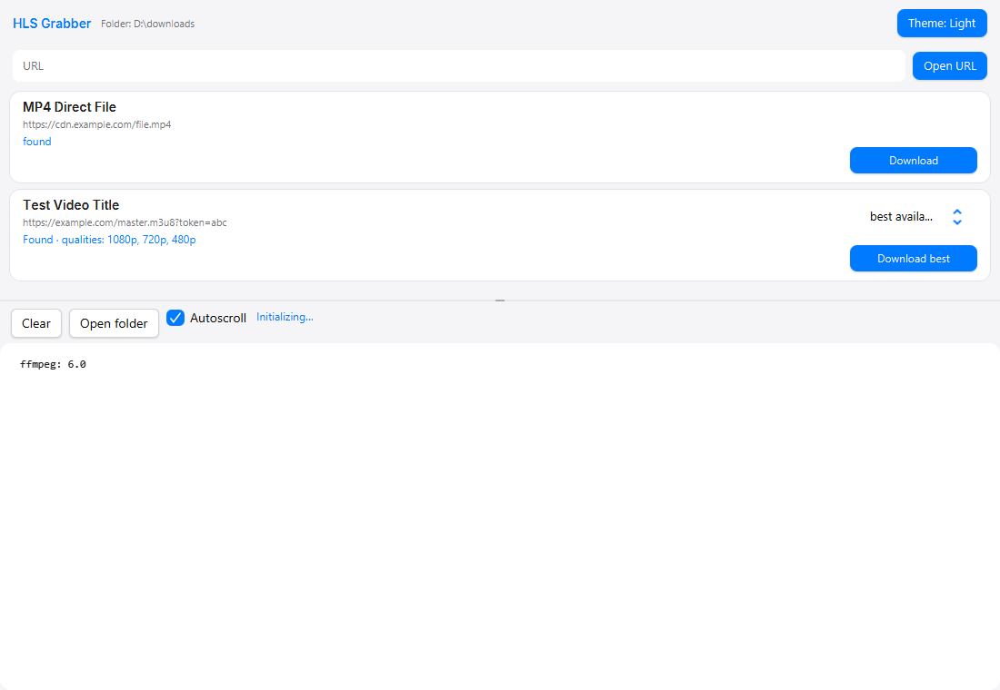
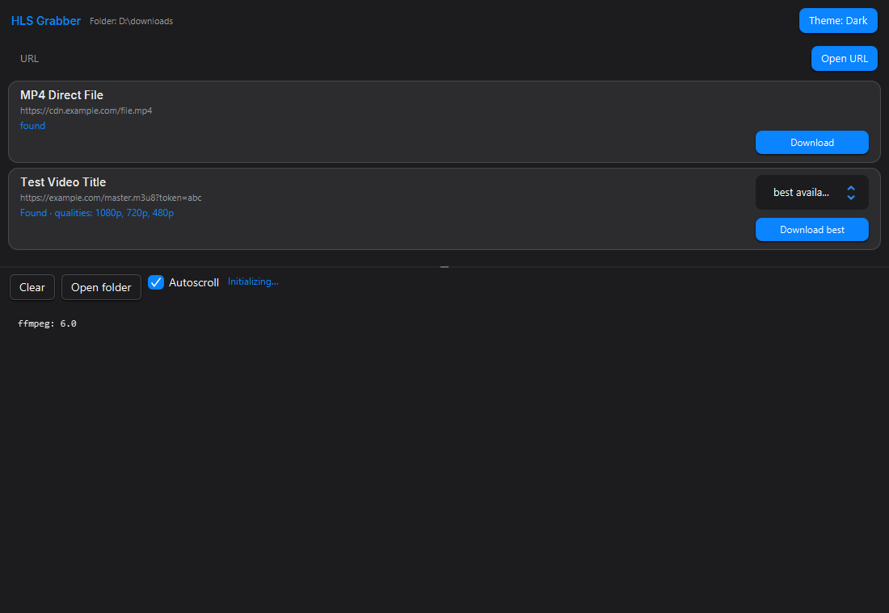

# HLS Grabber

Self-contained Windows app for HLS (`.m3u8`) downloads. JavaFX interface with Cupertino
light and dark themes, native Mica titlebar, bundled Inter font.
Capture stream sources from a page, download segments in parallel, save MP4 without re-encoding.




**[Download for Windows x64](https://github.com/flynet/media_downloader/releases/download/v2.0.0/HLS-Grabber-2.0.0-windows-x64.zip)** — self-contained build with a bundled Java runtime, no Java install needed. The JAR, SHA256 checksums, and full details are in [Releases](https://github.com/flynet/media_downloader/releases).

## Releases

| File | What it is | Date | SHA256 |
| --- | --- | --- | --- |
| `HLS-Grabber-2.0.0-windows-x64.zip` | Full Windows app: UI + bundled Java runtime + bundled browsers (no Java install required). | 08.11.2026 | `DE52070E8502235E9BA73312E492B9D71986CE22CCB2F68EE7294BF219E20621` |
| `HLS-Grabber-2.0.0.jar` | Fat JAR for Windows x64 (requires Java 21). | 08.11.2026 | `3C7A679780A1F740EDFAE6A54BC8A45D47665AB908F5BEC7D87585BA93A37A02` |

Download from [Releases](https://github.com/flynet/media_downloader/releases).

Full SHA256 values:

```
sha256: DE52070E8502235E9BA73312E492B9D71986CE22CCB2F68EE7294BF219E20621
sha256: 3C7A679780A1F740EDFAE6A54BC8A45D47665AB908F5BEC7D87585BA93A37A02
```

### How to install

1. Unpack the zip to any folder.
2. Run `HLS Grabber.exe` — no installation required.
3. SmartScreen (Windows): the first launch of an unsigned exe can be blocked by a security warning. Use **More info** → **Run anyway**.
   > The SmartScreen warning is standard Windows behavior for unsigned exe files. The app installs nothing and needs no admin rights.

### Running the JAR

[Download the JAR](https://github.com/flynet/media_downloader/releases/download/v2.0.0/HLS-Grabber-2.0.0.jar) and run it with Java 21 on Windows x64 (the JavaFX native libraries bundled in the JAR are Windows-only):

```powershell
java -jar HLS-Grabber-2.0.0.jar
```

URL capture opens a browser window — the app uses your system Chrome or Edge with a private app profile, and falls back to a bundled Chromium. On first launch the FFmpeg binaries are extracted from the JAR into a temporary cache; nothing is installed system-wide.

## Features

- HLS (`.m3u8`) master and media playlists, AES-128 segment decryption
- Live URL capture: network sniffer in a browser window (system Chrome/Edge profile, bundled Chromium fallback)
- YouTube stream support (signed stream chunks, dedup by video id)
- Parallel segment downloads, retry policy, cancel-safe
- MP4 muxing without re-encode via bundled FFmpeg
- Light and dark themes (Cupertino), native Mica titlebar, bundled Inter font
- GUI log panel, live progress, settings persisted per user (`%APPDATA%\hlsgrabber`)

## Building from Sources

### Requirements

| Tool | Notes |
| --- | --- |
| JDK 21.0.x | Temurin Hotspot is the shortest path |
| Maven | 3.8+ |
| Windows x64 | `jpackage` ships with JDK 21 |

### Paths in the script

`build_appimage.bat` contains developer-specific paths:

```bat
set "JDK=C:\Program Files\Eclipse Adoptium\jdk-21.0.12.101-hotspot"
set "MAVEN_CMD=C:\mvn\bin\mvn.cmd"
```

Change these lines to your machine's paths before running the build. Playwright browsers are bundled from `%LOCALAPPDATA%\ms-playwright` (`chromium-1248`, `chromium_headless_shell-1248`, `ffmpeg-1013`, `winldd-1007`).

### Commands

```powershell
# Verification (55 tests)
mvn -q clean test

# Full app-image build: Maven fat jar + jlink + jpackage + Playwright browsers
cmd /c build_appimage.bat
```

The script builds the fat jar, creates a minimal Java runtime with `jlink`, assembles a self-contained app with `jpackage`, copies Playwright browsers into `app/browsers`, and launches the app.

**Steps**

1. Change the paths (JDK / Maven)
2. Run `cmd /c build_appimage.bat`
3. The script writes `appimage\dist\HLS Grabber\`

## Repository Layout

```
media_downloader/
├─ build_appimage.bat              jpackage app-image build (Windows)
├─ images/                        screenshots (light/dark themes)
├─ Downloader_hub/
│  ├─ pom.xml                     Maven build (JavaFX, AtlantaFX, Playwright, FFmpeg, JNA)
│  ├─ src/main/java/com/flynet/hlsgrabber/
│  │  ├─ App.java                entry point
│  │  ├─ browser/               system browser launch + network sniffer
│  │  ├─ config/                settings persistence
│  │  ├─ download/              parallel segments, decryption, HTTP fetch, retry
│  │  ├─ ffmpeg/                FFmpeg runner
│  │  ├─ hls/                   m3u8 parsing (master/media playlists, keys)
│  │  ├─ manifest/              source detection and registry
│  │  ├─ ui/fx/                 JavaFX UI (window, themes, Mica, source rows, log appender)
│  │  ├─ util/                  filename/URL helpers
│  │  └─ youtube/              YouTube API and downloader
│  ├─ src/main/resources/        Inter fonts, icon, logback.xml
│  └─ src/test/java/            unit tests + UI/theme harnesses (55 tests)
```

## Localization

The interface is in English; the light and dark themes and the download folder are chosen in the app window and saved per user in `%APPDATA%\hlsgrabber\settings.properties`.

Интерфейс приложения — на английском языке. Светлая/тёмная тема и папка загрузок выбираются в окне приложения и сохраняются в `%APPDATA%\hlsgrabber\settings.properties`.

## License

The program is distributed as is, without any warranty.
