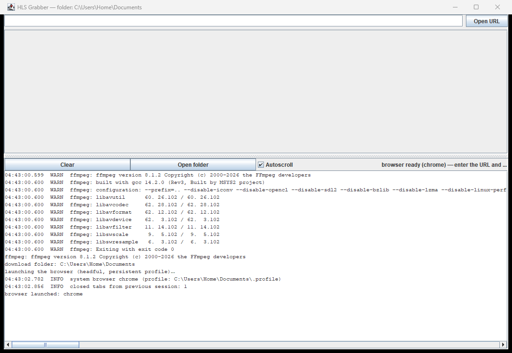

# HLS Grabber

Self-contained app for HLS/DASH downloads (Windows, Linux, macOS).
Open an m3u8/mpd, choose segments, save MP4/MKV without re-encoding.



**[Download for Windows x64](https://github.com/flynet/media_downloader/releases/download/v1.0.0/HLS-Grabber-1.0.0-windows-x64.zip)** — self-contained build with bundled runtime, no Java install needed. The JAR, SHA256 checksums, and full details are in [Releases](https://github.com/flynet/media_downloader/releases).

## Releases

| File | What it is | Date | SHA256 |
| --- | --- | --- | --- |
| `HLS-Grabber-1.0.0-windows-x64.zip` | Full Windows build: app + bundled runtime (no Java install required). | 08.11.2026 | `847439D8…9DB6` |
| `HLS-Grabber-1.0.0.jar` | Cross-platform JAR (Windows, Linux, macOS; requires Java 21). | 08.11.2026 | `51EC5B33…74E8` |

Download from [Releases](https://github.com/flynet/media_downloader/releases).

Full SHA256 values:

```
sha256: 847439D8AEF774650CF4717A6DF7C78EC2C9380D497669E43F6E503068BC9DB6
sha256: 51EC5B337BE0809EE7AA52393351F7D3243346DF12B3900A6A6BD65F12CD74E8
```

### How to install

1. Unpack zip to any folder.
2. Run `HLS Grabber.exe` — no installation required.
3. SmartScreen (Windows): first launch of an unsigned exe can be blocked by a security warning. Use **More info** → **Run anyway**.
   > The SmartScreen warning is standard Windows behavior for unsigned exe files. The app installs nothing and needs no admin rights.
4. If `HLS Grabber.exe` fails to start (a log in `app.log` reports a missing runtime):
   - Install [Java 21](https://adoptium.net/temurin/releases/?version=21)
   - Put `HLS-Grabber-1.0.0.jar` in the same folder as `HLS Grabber.exe`
   - Run `HLS Grabber.exe` again — the app finds system Java and starts
   > Do not place `HLS-Grabber-1.0.0.jar` in the app folder without `HLS Grabber.exe` — the JAR is not double-clickable, use `java -jar`.

### Running the JAR on Linux and macOS

[Download the JAR](https://github.com/flynet/media_downloader/releases/download/v1.0.0/HLS-Grabber-1.0.0.jar) and run it with Java 21. FFmpeg binaries for Windows, Linux (x64/arm64) and macOS (x64/arm64) are bundled inside the JAR — no system FFmpeg is needed.

1. Install Java 21: [Temurin](https://adoptium.net/temurin/releases/?version=21).
2. Run:
   ```bash
   java -jar HLS-Grabber-1.0.0.jar
   ```
3. URL capture opens a browser window — the app uses your system Chrome or Edge. If you have neither, install Chromium once:
   ```bash
   java -cp HLS-Grabber-1.0.0.jar com.microsoft.playwright.CLI install chromium
   ```
   The browser lands in `~/.cache/ms-playwright` (Linux) and `~/Library/Caches/ms-playwright` (macOS).

On first launch the FFmpeg binaries are extracted from the JAR into a temporary cache; nothing is installed system-wide.

## Features

- HLS (.m3u8) and DASH (.mpd) streams
- Parallel segment downloads, configurable worker count
- MP4/MKV muxing without re-encode
- Live progress bar and log
- Playlists and batch downloads
- Media MD5 export
- 30 UI languages
- Bundled Chromium for URL capture
- 4K UHD + HDR10, HEVC

## Building from Sources

### Requirements

| Tool | Notes |
| --- | --- |
| JDK 21.0.x | Hotspot is the shortest path |
| Maven | 3.8+ |
| Windows | `jpackage` needs Wix Toolset MSI installed first |
| MSYS2 | Only for AppImage builds |

### Paths in the script

`build_appimage.bat` contains developer-specific paths:

```bat
set "JDK=C:\Program Files\Eclipse Adoptium\jdk-21.0.12.101-hotspot"
set "MSYS=C:\msys64"
set "MVN=C:\maven\apache-maven-3.9.12\bin\mvn.cmd"
set "PGBALL=C:\Program Files\Playwright Java\browsers"
```

Change these lines to your machine's paths before running the build.

### Commands

```powershell
# Verification (54 tests)
mvn -q -DskipTests=false test

# Full AppImage build: Maven jar + jlink + jpackage + Playwright browsers
cmd /c build_appimage.bat
```

The script builds the Maven jar, creates a minimal Java runtime with `jlink`, then assembles a self-contained app with `jpackage`. Playwright browsers (`chromium-1248`, `chromium_headless_shell-1248`, `ffmpeg-1013`, `winldd-1007`) are copied into `app/app/browsers`.

**Steps**

1. Change paths (JDK / MSYS / Maven / Playwright browsers)
2. Run `cmd /c build_appimage.bat`
3. The script writes `appimage\dist\HLS Grabber\`

## Repository Layout

```
HLS Grabber/
├─ build_appimage.bat           jpackage AppImage build (Windows)
├─ .gitignore
├─ bin/
│  ├─ HlsGrabber              Linux launcher script
│  └─ com.flynet.hlsgrabber.App  launcher metadata
├─ src/main/java/com/flynet/hlsgrabber/
│  ├─ App.java                Swing UI
│  ├─ I18n.java             30 languages
│  ├─ AppLogger.java        app.log
│  ├─ UrlResolver.java      Playwright URL capture
│  ├─ DownloadWorker.java   parallel segments
│  ├─ MpdParser.java        DASH .mpd
│  └─ M3u8Parser.java       HLS .m3u8
└─ src/test/java/com/flynet/hlsgrabber/
   ├─ AppTest.java
   └─ DownloadWorkerTest.java
```

## License

The program is distributed as is, without any warranty.
